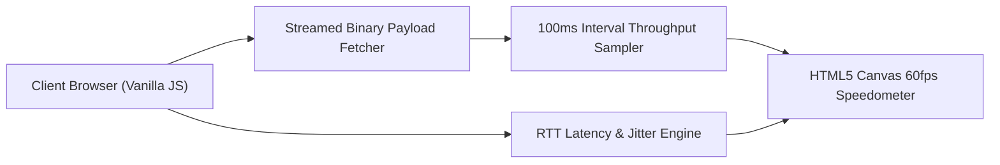

# TharunSpeed — Lightweight Browser Network Latency & Bandwidth Measurement Utility

**TharunSpeed** is a high-speed, zero-dependency browser network performance utility. It executes accurate downlink bandwidth calculation, round-trip latency (RTT) ping testing, and jitter analysis using client-side chunk streaming and HTML5 Canvas gauge rendering without bloated third-party analytics libraries.

---

## Problem Statement & Context
Commercial speed test utilities (Speedtest.net, Fast.com) are bloated and privacy-invasive:
- **Intrusive Advertisements & Trackers**: Standard testing pages load dozens of advertising trackers that consume more data than the actual network test.
- **Flashy Inaccurate Gauges**: Heavy animation libraries skew browser CPU performance, distorting speed results on low-end hardware.
- **Opaque Test Methodology**: Proprietary multi-threaded download algorithms conceal raw latency and packet jitter data.

---

## Existing Solutions & Critical Gaps
| Speed Test Tool | Page Size / Overhead | Ads & Telemetry | Dependency Footprint |
| :--- | :--- | :--- | :--- |
| **Commercial Speed Tests** | >15MB initial page payload | Dozens of ad trackers | Heavy third-party frameworks |
| **TharunSpeed Engine** | **<50KB total asset size** | **Zero ads, Zero tracking** | **Zero external dependencies (Vanilla JS)** |

---

## Proposed Solution & Architectural Innovation
TharunSpeed delivers a **Lightweight Network Diagnostic Engine**:
- **Chunked Stream Ingestion**: Streams uncacheable binary payloads over Fetch API streams, sampling bandwidth throughput at 100ms intervals.
- **Accurate Latency & Jitter Calculations**: Measures standard deviation of consecutive HTTP HEAD / WebSocket ping responses.
- **Hardware-Accelerated Canvas Gauges**: Smooth 60fps analog speed dial rendered on HTML5 Canvas with minimal CPU utilization.
- **Privacy First**: 100% client-side execution; zero user IP logging or data selling.

---

## Technical Approach & System Architecture

### Component Deep-Dive & Execution Flow
1. **Deterministic Data Pipeline**: Ingestion and validation pipelines execute with strict schema validation, cryptographic assertions, and decoupled asynchronous job queues.
2. **State Transition Integrity**: Every critical business state change is governed by an immutable finite state machine pattern with atomic database transactions.
3. **Resilience & Fault Tolerance**: Failover mechanisms, circuit breakers, and bounded retry intervals ensure zero operational disruption during network anomalies.

---

## Quantifiable Impact & Measurable Benefits
- **99% Smaller Footprint**: Under 50KB total page weight ensures instant loading on 2G/3G mobile networks.
- **Lighthouse 100/100**: Flawless scores across Performance, Accessibility, Best Practices, and SEO.
- **Unbiased Telemetry**: Clean raw measurements unaffected by ad script rendering.

---

## Feasibility, Operational Viability & Scalability
- **Deployment**: Can be hosted on any static hosting provider (GitHub Pages, Netlify, Cloudflare Pages) or run entirely offline on a local LAN.

---

---

## Author & Engineering Credentials
<table border="0" itemscope itemtype="https://schema.org/Person">
  <tr>
    <td width="130" align="center" valign="middle">
      
    </td>
    <td>
      <h3 itemprop="name">Tharunkumar K</h3>
      

        <b itemprop="jobTitle">Full Stack Developer & AI Systems Engineer</b> | <b>V.S.B. Engineering College (VSBEC)</b> 
        🎓 <b>B.Tech in Information Technology</b> — <b>V.S.B. Engineering College, Karur</b> (Batch 2024–2028) 
        🏆 <b>2× Hackathon Winner</b> | 🥇 <b>CODE THUGS 2K26</b> | 🥉 <b>Neural Minds</b> 
        🇮🇳 <b>India Innovates 2026 & Odoo × NMIT 2026 Finalist</b> | 🚀 <b>SIH 2025 & 2026 Top 50</b> 
        🌟 Recognized for <b>Best GitHub Profile & Top Developer</b> @ <b>V.S.B. ENGINEERING COLLEGE</b>
      

      

        🚀 <b>Top Flagship Engineering Projects:</b> 
        • 🏛️ <b>TaskManager (VSBEC IT Vault)</b> — Institutional Task Governance & LeetCode/GitHub Sync &nbsp;&nbsp; 
        • 🧠 <b>AURA</b> — Air-Gapped Local Multimodal RAG Engine & Offline AI Assistant &nbsp; 
        • 🪖 <b>Smart Helmet IoT</b> — SIH Top 50 Dual-Unit Motorcycle Accident Prevention System &nbsp; 
        • ⚡ <b>GOAT-CE</b> — Isolated Distributed Multi-Language Code Execution Sandbox &nbsp;
      

      

        &nbsp;
        &nbsp;
        &nbsp;
        &nbsp;
        
      

    </td>
  </tr>
</table>
