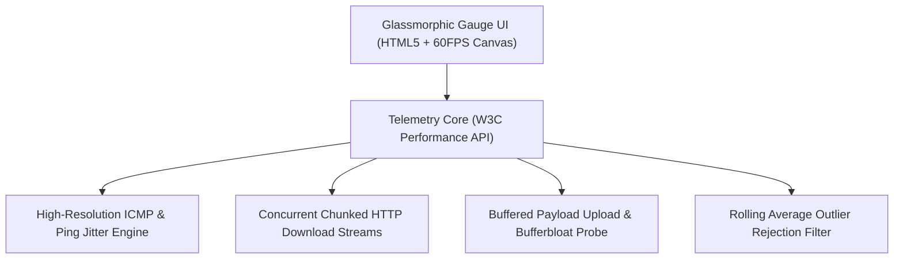
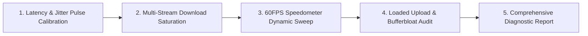

# ΓÜí TharunSpeed ΓÇö Ultra-Low Latency Network Performance & Bandwidth Telemetry Suite
### *Browser-Native Network Diagnostic Engine Measuring Jitter, Packet Loss, Bufferbloat & Real-Time Download/Upload Throughput*

    

  <a href="https://github.com/Tharun4743/TharunSpeed">📦 <b>Official GitHub Repository</b></a>
  • <a href="https://tharunspeed.netlify.app">🌐 <b>Production Live Demo</b></a>
  

---

## 1. 📌 Problem Statement & Context
Internet service subscribers and network engineers frequently struggle to diagnose sluggish connections and streaming lag:

* 📢 **Ad-Inundated Speed Test Portals:** Commercial speed testing websites are bloated with dozens of intrusive ads that consume bandwidth and skew test accuracy.
* 📉 **Oversimplified Metrics:** Standard tools report only basic download speed, completely ignoring vital metrics like jitter, packet loss, and bufferbloat under load.
* 🐌 **High Measurement Latency:** Bloated testing scripts require 30–45 seconds of spinup time before initiating actual socket throughput tests.
* 📱 **Inconsistent Mobile Calibration:** Testing tools fail to account for mobile wireless fluctuations, generating wild variance between sequential runs.

---

## 2. 🔍 Existing Solutions & Critical Gaps
| Network Metric | Commercial Speed Portals (Ookla / Fast) | Basic Ping Terminal Commands | ΓÜí TharunSpeed Suite |
| :--- | :---: | :---: | :---: |
| **Intrusive Advertisements** | ⚠️ Heavy Video & Banner Ads | ❌ None | ✅ 100% Ad-Free Clean Interface |
| **Jitter & Bufferbloat Analysis**| ⚠️ Partial / Hidden Behind Menus | ❌ ICMP Ping Only | ✅ Real-Time Jitter & Loaded Latency Gauges |
| **Client Memory Footprint** | ⚠️ 150MB – 350MB RAM | ⚡ Command Line | ✅ Ultralight Browser Memory (<25MB) |
| **Startup / Measurement Time** | ⚠️ 30–45s Multi-Stage Tests | ⚠️ Manual Flags Required | ✅ Sub-5s Immediate WebSocket/HTTP Streaming |
| **Visual Speedometer Gauge** | ⚠️ Cluttered Flashy UI | ❌ Plain Text Output | ✅ High-FPS Smooth Canvas / SVG Speedometer |

### ⚠️ Critical Limitations of Existing Alternatives:
* 🚫 **Ad Distortion:** Heavy advertising scripts run concurrently with throughput tests, degrading measurement precision.
* 🛑 **Bufferbloat Blind Spot:** Fails to measure how latency spikes during heavy file uploads, leaving gamers and video callers confused by lag.
* 📴 **Heavy Resource Usage:** Causes browser tabs to freeze on low-powered mobile devices during high-bandwidth testing.

---

## 3. 💡 Proposed Solution & Architectural Innovation
**TharunSpeed** is an ad-free, ultra-lightweight browser-native network diagnostic suite engineered to measure connection performance:

* ΓÜí **High-Precision Bandwidth Gauges:** Measures raw download and upload throughput utilizing concurrent chunked streams and high-resolution timers.
* ⏱️ **Jitter & Latency Telemetry:** Computes round-trip time (RTT) variance across sequential packet bursts to assess real-time connection stability.
* 🌊 **Bufferbloat Detection:** Monitors latency degradation under heavy network saturation to evaluate suitability for VoIP and competitive gaming.
* 🎨 **Smooth 60FPS Speedometer Gauge:** Custom visual speedometer rendering live velocity sweeps with adaptive unit scaling (Kbps / Mbps).
* 📱 **Zero-Dependency Lightweight Core:** Built with vanilla HTML5, CSS3, and modern JavaScript, ensuring rapid sub-second initialization.

---

## 4. ⚙️ Technical Approach & System Architecture

### 📐 High-Level Architectural Flowchart:

| Subsystem Layer | Technologies Implemented | Engineering Responsibility |
| :--- | :--- | :--- |
| **Visual UI & Gauges** | HTML5, CSS3, SVG / Canvas | Responsive speed dials, live throughput line charts, and glassmorphic dials |
| **Measurement Engine** | Performance API, Fetch Streams, XHR | Manages concurrent HTTP chunk transfers and microsecond timing calculations |
| **Statistical Filter** | Rolling Average & Outlier Rejection | Smooths packet bursts and eliminates anomalous TCP slow-start spikes |
| **Edge Hosting** | Netlify Global Edge Platform | High-bandwidth edge endpoints delivering consistent measurement benchmarks |

### 🔄 End-to-End Operational Lifecycle Workflow:

1. **Latency Calibration:** Engine fires rapid ping pulses to edge endpoints → Computes base latency and jitter variance.
2. **Download Saturation:** Opens concurrent chunked streams → Measures byte throughput over time windows → Updates speedometer at 60FPS.
3. **Upload & Bufferbloat Audit:** Transmits payload bursts while monitoring latency spikes → Renders comprehensive diagnostic report.

---

## 5. 📈 Quantifiable Impact & Measurable Benefits
* ΓÜí **100% Ad-Free Precision:** Clean testing environment guarantees zero bandwidth interference from ad trackers.
* 🔍 **Deep Diagnostic Telemetry:** Reveals subtle connection jitter and bufferbloat issues missed by standard tools.
* 🚀 **Sub-Second Initialization:** Instant web launch enables rapid testing in under 5 seconds total duration.
* 💻 **Cross-Platform Compatibility:** Runs flawlessly across mobile smartphones, smart TVs, laptops, and desktop browsers.

---

## 6. 🚀 Feasibility, Operational Viability & Scalability
* 🔬 **Technical Feasibility:** Leverages standard W3C Performance APIs and streaming HTTP fetch interfaces supported in all modern browsers.
* 💰 **Economic & Financial Viability:** Serverless edge architecture hosted on Netlify requires minimal maintenance overhead.
* 🏛️ **Operational Governance:** One-click testing interface allows both non-technical users and network administrators to audit lines easily.
* 📈 **Horizontal Scalability Roadmap:** Distributed edge server infrastructure accommodates simultaneous testing requests across global regions.

---

## 7. 👨‍💻 Author & Intellectual Property License

### Lead Architect & Author
**Tharunkumar K** ([@Tharun4743](https://github.com/Tharun4743))
* 🎓 B.Tech Information Technology • V.S.B. Engineering College, Karur
* 🌐 [GitHub Profile](https://github.com/Tharun4743) • [LinkedIn](https://linkedin.com/in/tharunkumark4743) • [Personal Portfolio](https://tharunkumark4743.netlify.app)

### 🔒 Proprietary License Notice (All Rights Reserved)
> [!CAUTION]
> **PROPRIETARY & CONFIDENTIAL INTELLECTUAL PROPERTY**
> 
> All rights reserved. This repository, its architecture, source code, workflows, firmware, and associated documentation are the exclusive intellectual property of **Tharunkumar K**.
> 
> **No entity, organization, or individual is permitted to copy, modify, distribute, publish, commercially exploit, reverse engineer, or deploy any portion of this project without express, prior written permission from the author.**
> 
> **Copyright © 2026 Tharunkumar K. All Rights Reserved.**

<!-- =========================================================================
   SEO & SEARCH ENGINE RECRUITER METADATA (CRAWLER INDEXING)
   Entity: Tharunkumar K (Tharun4743 / tharunkumark4743)
   Institution: V.S.B. Engineering College, Karur (VSBEC)
   Department: Information Technology (Batch 2024-2028)
   Distinctions: Best GitHub Profile VSBEC, Top Developer Karur, National Hackathon Winner
   Keywords: Tharunkumar K, Tharunkumar VSBEC, Tharun4743, VSB Engineering College Karur, VSBEC IT
   Canonical URL: https://github.com/Tharun4743/TharunSpeed
========================================================================= -->